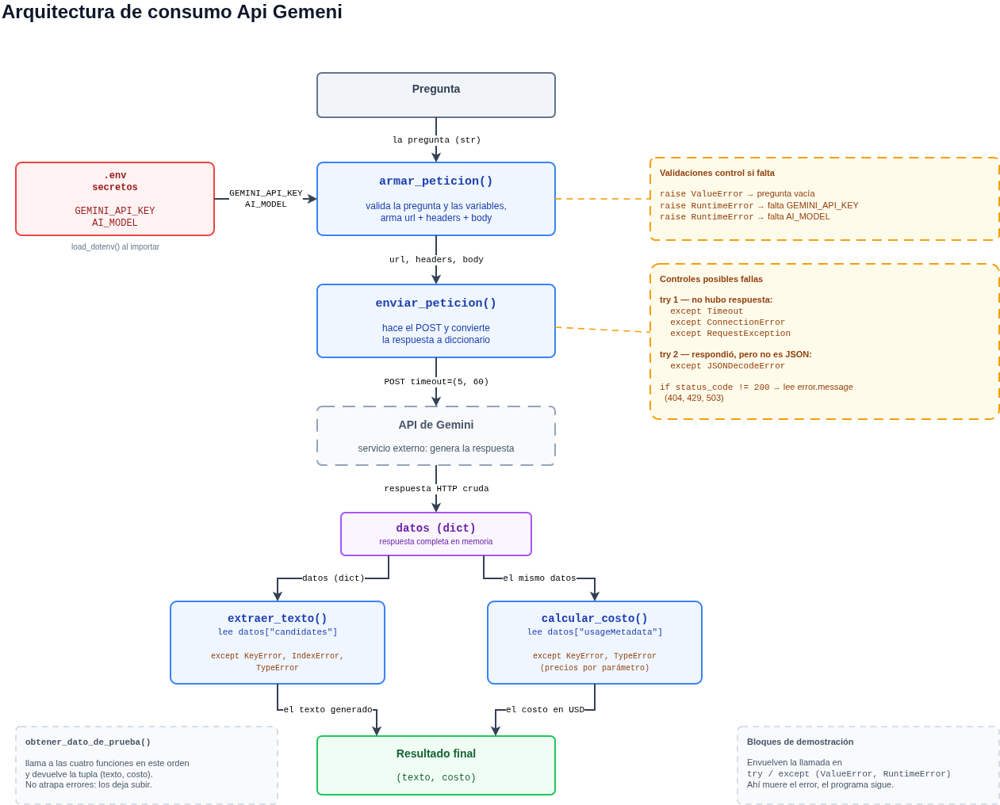

# Decisión de arquitectura: elección de modelo

| | |
|---|---|
| **Fecha** | 22-10-2026 |
| **Estado** | Vigente, con la latencia pendiente de volver a medir |
| **Autor** | Luis Aburto |
| **Ámbito** | Modelo de lenguaje que consume `src/consumir_gemini.py` |

---

## Modelo elegido

**Gemini 3.1 Flash-Lite** — identificador `gemini-3.1-flash-lite`.

Queda declarado en el archivo `.env`, de modo que cambiarlo no obliga a tocar el
código:

```
AI_MODEL=gemini-3.1-flash-lite
```

---

## Diagrama de arquitectura



El modelo entra en el flujo en un punto único: `armar_peticion()` lee `AI_MODEL`
desde el `.env` y lo inserta en la URL del endpoint. Las otras tres funciones
—`enviar_peticion()`, `extraer_texto()` y `calcular_costo()`— no dependen de qué
modelo se use, así que esta decisión se revierte cambiando una línea del `.env`,
sin modificar ningún archivo de código.

La única dependencia indirecta son los precios. Para que el costo calculado
siempre corresponda al modelo declarado, el módulo los guarda en una tabla
`PRECIOS_POR_MILLON` indexada por modelo: `precios_del_modelo()` toma los del
`AI_MODEL` vigente, y si el modelo no está en la tabla falla con un mensaje claro
antes de enviar la petición, en vez de reportar un costo equivocado sin avisar.

---

## Comparación de candidatos

Los dos candidatos son variantes del mismo proveedor: una económica y liviana,
otra más capaz. Los costos salen de la lista oficial de precios; la latencia y
los tokens, de mediciones propias con `src/comparar_modelos.py`.

### Costos — lista oficial del proveedor

Consultada el 22-10-2026 en <https://ai.google.dev/gemini-api/docs/pricing>.

| Criterio | Gemini 3.1 Flash-Lite | Gemini 3.8 Flash |
|---|---|---|
| Identificador | `gemini-3.1-flash-lite` | `gemini-3.8-flash` |
| Costo por 1.000 tokens de entrada | 0,000250 USD | 0,000750 USD |
| Costo por 1.000 tokens de salida | 0,001500 USD | 0,003750 USD |
| Nivel gratuito | Sí | Sí |
| Vigencia del precio | Sin cambio anunciado | Hasta el 31-12-2026 |

Relación actual: Flash cuesta **3 veces más** por token de entrada y **2,5 veces
más** por token de salida.

**Cambio de precio anunciado.** La página indica que, a partir del 1 de enero de
2027, Flash sube a 0,001500 USD por mil tokens de entrada y 0,007500 USD de
salida: el doble en ambos. Flash-Lite no tiene cambio anunciado. Desde esa fecha
la diferencia pasa a **6 veces** en entrada y **5 veces** en salida.

### Costo real de una petición — medido

Misma pregunta de prueba en ambos modelos.

| Criterio | Gemini 3.1 Flash-Lite | Gemini 3.8 Flash |
|---|---|---|
| Tokens de entrada | 10 | 10 |
| Tokens de salida | 5 | 9 |
| Costo de esa petición | 0,00001000 USD | 0,00004125 USD |
| Proyección a 50.000 peticiones/mes | 0,50 USD | 2,06 USD |

Flash cuesta **4,1 veces más** por petición real. La diferencia es mayor que la
de la lista de precios porque Flash además generó respuestas más largas: 9 tokens
de salida contra 5 para la misma pregunta.

### Latencia — medida, con una advertencia

Cuatro repeticiones de la misma pregunta por modelo, promediando al final.

| Criterio | Gemini 3.1 Flash-Lite | Gemini 3.8 Flash |
|---|---|---|
| Intento 1 | 6,59 s | 3,70 s |
| Intento 2 | 4,78 s | 2,70 s |
| Intento 3 | 8,31 s | 2,81 s |
| Intento 4 | 15,58 s | 3,13 s |
| **Promedio** | **8,82 s** | **3,08 s** |
| Mínimo / máximo | 4,78 s / 15,58 s | 2,70 s / 3,70 s |
| Dispersión | 3,3× | 1,4× |

**Estas dos columnas no son directamente comparables, y conviene decirlo.** Se
midieron en momentos distintos, y la columna de Flash-Lite se tomó durante un
episodio documentado de saturación: entre las mediciones válidas, el servicio
devolvió repetidamente HTTP 503 *"This model is currently experiencing high
demand"*, que el script tuvo que reintentar con espera exponencial.

La dispersión lo confirma: Flash-Lite varió 3,3 veces entre su medición más
rápida y la más lenta, contra 1,4 veces de Flash. Esa inestabilidad es la firma
de un servicio congestionado, no de un modelo lento.

Tomada al pie de la letra, la tabla dice que Flash-Lite es 2,9 veces más lento.
Esa conclusión no se sostiene con la evidencia disponible, y queda pendiente
repetir ambas mediciones en una misma ventana para confirmarla o descartarla.

### Calidad para mi caso concreto

Evaluada sobre preguntas representativas de lo que la miniaplicación necesita
responder.

| Criterio | Gemini 3.1 Flash-Lite | Gemini 3.8 Flash |
|---|---|---|
| Preguntas respondidas | 2 de 3 (una cortada por 503) | 2 de 3 (una cortada por 503) |
| Resultado | Correcto y suficiente: cubre lo esencial con respuestas más breves | Correcto, con más desarrollo y ejemplos en las mismas preguntas |

Ninguno de los dos se equivocó en el contenido. La diferencia es de extensión,
no de exactitud: Flash desarrolla más, Flash-Lite responde más corto.

### Límite operativo del nivel gratuito

Dato que apareció durante las mediciones y conviene dejar registrado: el nivel
gratuito permite **20 peticiones diarias por modelo**.

```
Quota exceeded for metric: generate_content_free_tier_requests,
limit: 20, model: gemini-3.8-flash
```

El script de comparación gasta 7 peticiones por modelo, 14 por corrida completa,
así que alcanza para una corrida al día. La proyección a 50.000 peticiones
mensuales de la tabla anterior es un ejercicio de costo: con el nivel gratuito
ese volumen no es alcanzable, y llegar ahí exigiría pasar a un plan de pago.

---

## Justificación

El criterio que más pesa en mi caso es el **costo**, y es además el único de los
tres que quedó medido sin reservas. Flash cuesta 4,1 veces más por petición real,
y la diferencia se amplía a partir del 1 de enero de 2027, cuando su precio se
duplica mientras el de Flash-Lite no cambia.

Ese costo no compra nada que mi caso aproveche. La miniaplicación pide
confirmaciones y respuestas de una o dos frases. En la evaluación de calidad los
dos modelos respondieron correctamente; la diferencia fue de extensión, y Flash
generó casi el doble de tokens de salida para decir lo mismo. En una tarea donde
la respuesta correcta cabe en una frase, pagar por desarrollo adicional es pagar
por algo que no se usa.

La **latencia** es el criterio donde los datos no alcanzan para concluir. Las
mediciones crudas favorecen a Flash por un margen amplio, pero se tomaron en
ventanas distintas y la columna de Flash-Lite está contaminada por un episodio de
saturación del servicio. Prefiero dejar el dato registrado con su advertencia
antes que apoyar la decisión en una comparación que sé que no es limpia.

La **calidad** pesa poco, porque el umbral que necesito es bajo: cubrir lo
esencial es exactamente el requisito, y ambos modelos lo cumplen.

Decido por costo, que es la evidencia sólida, y dejo la latencia como punto
abierto. Si al repetir las mediciones en una misma ventana Flash-Lite resultara
efectivamente dos o tres veces más lento, esta decisión hay que revisarla: una
espera de nueve segundos sin streaming es un problema de experiencia de uso que
el ahorro de 1,56 USD mensuales no compensa.

---

## Alternativa descartada y por qué

**Descarté Gemini 3.8 Flash** (`gemini-3.8-flash`), que era el modelo declarado
en mi `.env` desde el Bloque 4.

La razón concreta no es que sea peor: respondió bien, más rápido en las
mediciones disponibles, y con respuestas más desarrolladas. El problema es que
**esa capacidad se paga en cada petición, la necesite o no la pregunta**. Cobra
4,1 veces más por petición real para resolver tareas que Flash-Lite resuelve con
la misma exactitud, y mi caso no tiene ninguna consulta que justifique esa
diferencia. Lo descarté por sobredimensionado para el problema, no por
deficiente.

El cambio de precio anunciado para enero de 2027 refuerza la decisión sin haber
sido su motivo: desde esa fecha Flash pasa a costar el doble y la diferencia se
abre a 6 veces en entrada. Si la elección hubiera sido la contraria, habría que
rehacerla en menos de tres meses.

Esta decisión se revisa si la miniaplicación cambia de propósito —razonamiento
más largo, análisis de textos extensos, respuestas con matices— o si una medición
limpia de latencia confirma la diferencia que sugieren los datos actuales.
